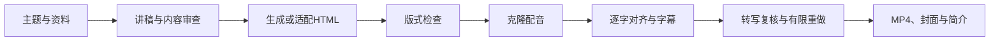

# Knowledge Video Studio

[](https://github.com/khakhasshi/knowledge-video-studio/actions/workflows/tests.yml)
[](LICENSE)

本地知识视频制作工具。输入主题，选择自己的参考录音和 HTML 课件风格，生成配音、课件、字幕、章节、封面、简介和 1080p 视频。

A local studio for narrated educational videos. Bring a topic, an authorized voice sample and an HTML slide template. The workflow produces slides, narration, subtitles, chapters, a cover and an MP4.

**声音决定时间轴。** 自然段配音完成后，字幕和翻页跟随真实音轨。变速保留音高，同时调整字幕与页面时间。

## 快速开始

支持 macOS 和 Linux。需要联网下载运行依赖与模型；Windows 原生未验收，WSL 按 Linux 环境准备。

```sh
git clone https://github.com/khakhasshi/knowledge-video-studio.git
cd knowledge-video-studio
./scripts/install
./scripts/start
```

打开 **http://127.0.0.1:8770/**。

安装器准备 Python 3.11、Node.js 22+、固定提交的 OmniVoice Studio 和视频依赖。私有语音环境位于 `.runtime/omnivoice/`。系统工具需要 Git、FFmpeg、Chrome/Chromium 和所用语言的字体；macOS 自动安装系统工具需要已有 Homebrew，Debian/Ubuntu 可能需要 sudo。已有依赖时可执行 `./scripts/install --skip-system-deps`。权重在网页中按需下载，不包含在 Git 仓库中。

1. 展开“模型与服务设置”，选择视频语言、识别模型，下载并载入模型。
2. 选择模型入口。Codex CLI 使用本机登录；外部模型填写 Base URL、模型名和 API Key。
3. 上传本人或获授权的参考录音，或填写本机路径、已有声音档案。逐字稿可填可不填。
4. 选择通用模板、自定义模板，或指定已有 HTML 课件。检查预览后输入主题并启动。
5. 等待制作完成，在结果页播放和下载。失败任务保留进度，可继续或查看原因。

首次使用前请阅读[详细安装与配置](docs/SETUP.md)。下载耗时取决于网络，语音生成速度取决于硬件；当前不提供统一的最低显存或内存保证。

## 三种使用方式

| 方式 | 内容由谁完成 | 入口 |
| --- | --- | --- |
| 网页 + Codex CLI | 用户本机登录的 Codex，按阶段自动调用 | 网页选择 Codex CLI；模型留空沿用用户配置 |
| 网页 + 外部模型 | OpenAI 兼容 Chat Completions 服务 | 网页填写接口、模型与密钥 |
| 当前助手直接制作 | 当前会话中的助手写稿、审查、制作 HTML | 阅读[助手制作指南](docs/ASSISTANT_WORKFLOW.md)，调用媒体 CLI |

第三种是助手操作现有工具的工作方式，不是网页中的第三个供应商选项。它不需要再启动一个 Codex CLI 内容会话。直接制作的媒体项目也不会自动出现在网页任务列表中。

Codex CLI 的认证和结构化输出使用[官方非交互接口](https://learn.chatgpt.com/docs/non-interactive-mode)。本项目不复制登录凭证，不包含共享账户或免费模型额度。外部接口费用由所选服务决定。

## 主要能力

- 主题策划、资料获取、自然口播、内容审稿、HTML 课件与版式检查。
- 资料可选。获取不到资料时可使用通用知识和明确标注的假设算例，保留依据说明。
- 参考模板生成课件，或为已有 HTML 配音；原课件保持不变。
- 本地声音克隆、逐字对齐、ASR 转写复核、失败段落有限重做。
- 1.2 倍默认播放速度，保留完整源音轨，字幕和翻页同步变速。
- 中、英、日、韩、法、德、西、意、葡、俄语言入口，Small / Medium / Large v3 转写模型选择。
- 自动封面与简介，历史成片可单独重新生成发布素材。
- 私有任务目录、阶段缓存、取消与中断续跑。



## 模板与数据

仓库包含通用教学模板与一个[两页离线示例](examples/assistant/slides.html)。自定义品牌模板放在本机 `.studio/templates/<名称>/`，或直接选择 HTML 完整路径。Zero2Quant 品牌课件、Logo、个人录音、声音档案、API 配置、模型权重和生产视频不随源码分发。

`.studio/` 保存任务和产物，`.runtime/` 保存私有运行环境。外部服务会收到完成任务所需的文本，启用视觉能力时还会收到截图。参考录音仅发送给指定语音服务。API Key 保留在服务内存，或从进程环境读取。服务默认只监听本机，参见[数据与部署边界](docs/SECURITY.md)。

## 验证范围

中文视频生产与英文媒体链已在 macOS / Apple Silicon 上运行。其余语言有配置入口，未逐项完成听感和成片验收。Linux CI 检查代码、Chrome 渲染与 FFmpeg 导出，不等同于所有 GPU、语音模型或供应商都已实测。

目标时长是写稿参考，不是精确时长保证。复杂嵌套 Reveal.js、连续动画、PPTX 导入、恶意 HTML 隔离和公网多用户部署不在当前支持范围。自动审稿和转写会出错，发布前仍应检查事实、完整试听并确认素材许可。程序不会自动上传到视频平台。

## 开发

```sh
python3.11 -m venv .venv
. .venv/bin/activate
pip install -e '.[dev]'
pytest -q
node --check knowledge_video/static/app.js
node --check narration_video/render_deck.mjs
python scripts/audit_release.py --history
python -m build
python scripts/package_source.py
```

开发测试不下载语音权重、不调用付费大模型。真实媒体制作另需 `[media]` 依赖及可用语音服务。

- [安装、语言模型和模板](docs/SETUP.md)
- [完整工作流与 LLM 的角色](docs/WORKFLOW.md)
- [当前助手直接制作](docs/ASSISTANT_WORKFLOW.md)
- [架构与扩展](docs/ARCHITECTURE.md)
- [验收记录](docs/ACCEPTANCE.md)
- [参与开发](CONTRIBUTING.md) · [版本记录](CHANGELOG.md)
- [第三方组件](THIRD_PARTY.md) · [MIT License](LICENSE)

应用源码使用 MIT 许可。OmniVoice Studio、模型权重、字体和用户模板分别遵循自己的许可。
