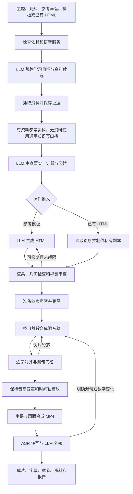

# 工作流与 LLM 的角色

最初的制作过程由人提出要求，LLM 在各工具之间判断和操作。工程化后，LLM 负责内容判断，程序负责可验证的时间与文件操作。

| 原来的工作 | LLM 在系统中的角色 | 程序负责的部分 | 产物 |
| --- | --- | --- | --- |
| 选择题目、理解观众 | 教学策划 | 校验时长与输入，读取已有课件 | research_plan.json |
| 查资料、判断论点 | 研究助理 | 抓取候选网页、保存正文和哈希，记录失败 | sources.json |
| 写自然口播 | 讲稿作者 | 校验段落 ID、页面映射、引用编号 | lesson_draft.json |
| 润色并核对数字 | 内容编辑 | 保留审查结果和完整修订稿 | editor_review.json |
| 匹配系列模板 | 课件设计师 | 复制显式引用的资源，检查接口与页面 ID | slides.html |
| 检查遮挡和版式 | 视觉审稿人或结构审稿人 | Chrome 截图、几何检查、有限重做 | layout_report.json |
| 导入本人声音 | 不需 LLM 猜测音色 | 音频解码、音量准备、本地 ASR、语音档案 | reference/ |
| 生成完整旁白 | 由语音模型承担 | 段落缓存、实际声音身份校验、重试 | narration_source.wav |
| 定字幕和翻页 | 不让 LLM 估算时间 | WhisperX 逐字强制对齐，置信度和连续漏字门槛 | timeline.json |
| 检查有没有漏读 | 转写审稿人 | ASR 转写，按段定位重录，保留旧结果 | speech_review_*.json |
| 调成 1.2 倍速 | 不需 LLM | 保持音高加速，字幕和页面同步缩放 | narration.wav |
| 导出并整理发布材料 | 复用已审定的内容 | FFmpeg、字数完整性、时长、编码与文件哈希检查 | video.mp4、SRT、章节 |

## 完整顺序

## 关键判断

**音轨是时间基准。** 先确定内容和页序，再生成自然段配音。页面不会把一句话切成多个语音请求。最终每个翻页标记都锚定在实际发声字符上。

**变速与重新生成分开。** 用户喜欢的声音不应因“说快一点”而重新改变发音方式。先保存完整源音轨，使用保持音高的时间变换。所有字幕和画面时刻使用同一比例。

**平均覆盖率不能遮住整句遗漏。** 在长段落中，漏掉一句也可能达到九成字符覆盖。本项目另外检查连续低置信度字符，再通过 ASR 与 LLM 核对整句和数字。转写本身也可能错，模型被要求忽略繁简体、同音字和数字书写差异。

**视觉检查有能力边界。** Codex 或支持图片的外部模型可以看抽样截图。只有文本能力的供应商不能被标记为完成了视觉审稿，它使用单独的结构审稿提示，读取 HTML、CSS、模板和浏览器几何报告。`quality.json` 的 `visual_review_mode` 区分 `images` 和 `html_only`。截图前等待字体、图片、有限动效和布局稳定；几何检查同时覆盖视口和会裁切内容的父容器。现有课件不自动改写样式，无法适配时会提示用户修正文件。

**自动化不等于保证正确。** 自动化负责可重复执行和有限修复。知识内容的事实正确性、授课节奏、本人音色相似度和版权许可仍需要发布者判断。程序不发布到任何社交平台。

参考资料是可选输入。没有候选网址或全部获取失败时，保存空的 `sources.json`，在 `research_basis.json` 记录 `general_knowledge`，并继续写稿。模型可以解释基础概念、展示推导和假设算例，但不能伪造来源和最新实测数据。`quality.json` 和视频说明保留内容依据。审稿仍检查计算、概念边界和具体事实，不能仅因资料为空拒绝制作。

## 讲稿编号兼容

外部模型审稿通过后，工作流会自动规范内部段落编号。连字符、空白、非 ASCII 字符、过长编号和重名会转换为唯一编号，并避开其他段落已使用的合法编号。口播、资料引用和 HTML 页面 ID 保持原样。已有课件的页序与页面唯一性仍需通过校验。

原始 `lesson_draft.json` 和 `editor_review.json` 保留不动，转换记录写入任务目录的 `id_normalization.json`。旧任务遇到编号格式错误时，可以直接点击“继续任务”，使用缓存讲稿恢复制作。

## 封面与发布简介

交付阶段调用 `knowledge_video.publishing`，输入最终讲稿，输出结构化封面文案、发布标题、简介和标签。简介追加真实章节时间、已有来源和讲稿中的知识边界。封面使用本地 HTML 排版和 Chrome 截图，不依赖额外图片生成服务。生成后检查文字是否越界。

每次生成写入私有任务目录 `publishing/<version>/`。封面及简介均成功后，才更新 `publishing.json` 与任务中的 publication 字段。旧版本保留。仅 PNG、简介和最终元数据可通过产物接口下载，原始模型输出、渲染配置和 HTML 不公开。

`POST /api/jobs/{id}/publishing` 为已完成的视频补做或重新生成素材，使用原任务模型配置和传入的 api_key；缺省时复用当前服务保存的密钥。端点沿用本机请求校验，在后台运行；原任务完成状态和视频不变。服务重启将未完成的素材任务标记为可重试。新视频自动执行此步骤；素材生成失败会单独显示失败原因，已检查的视频仍可交付。

## 当前会话直接操作

当前助手可以自行编写与审查内容，再调用相同媒体引擎。该模式不会再调用内容供应商，也不注册网页任务。具体文件约定、命令和审查责任见[助手制作指南](ASSISTANT_WORKFLOW.md)。
